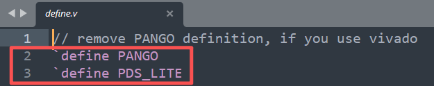
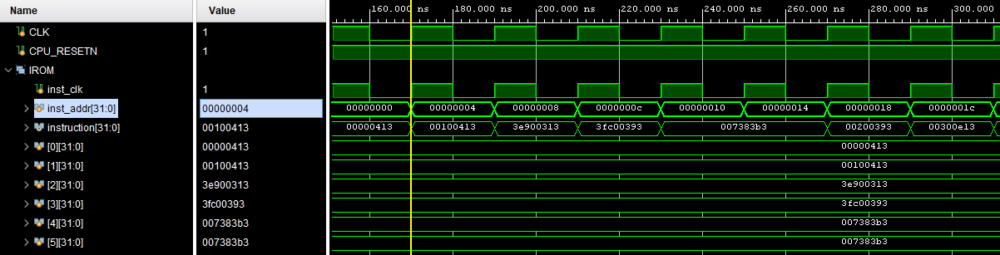
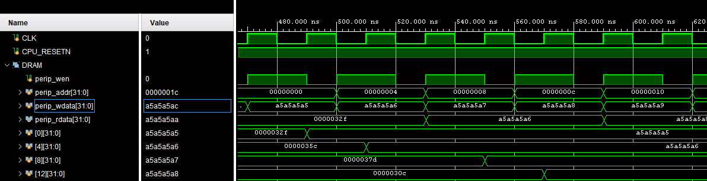
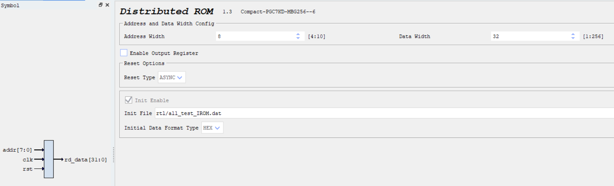
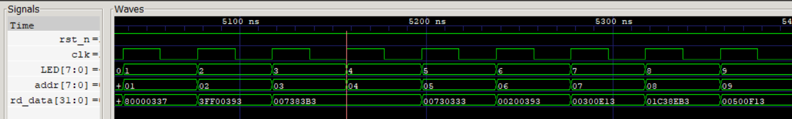
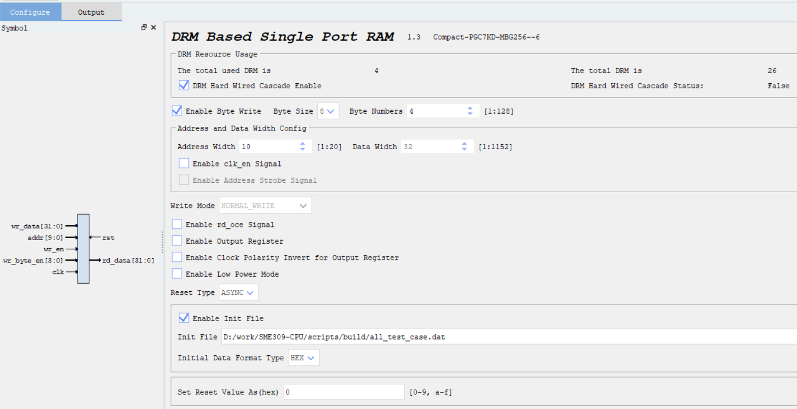
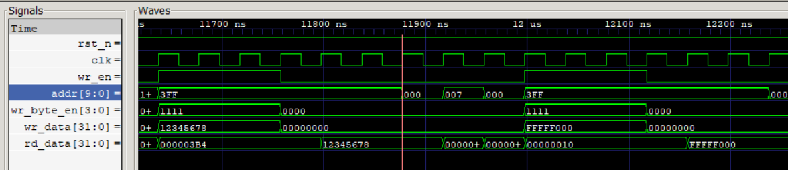

# SME309-CPU Project Overview and User Guide

SME309-CPU is an FPGA-based RISC-V RV32I processor project with a complete hardware and software environment: instruction and data memories (IROM/DRAM), test programs, memory-initialization conversion scripts, and hardware projects for synthesis, implementation, and device programming in Vivado and PDS.

## Building Programs and Initializing Memory

The `scripts` directory provides Windows batch scripts and conversion tools for building `.s` assembly programs into `.coe` and `.dat` files for IP memory initialization.

```text
scripts/
|-- src/                       # Assembly source files
|   `-- add_loop.s             # Addition-loop test program
|-- tools/                     # Conversion tools
|   |-- bin2coe.py             # Binary-to-COE converter
|   |-- bin2dat.py             # Binary-to-DAT converter
|   |-- coe2bin.py             # COE-to-binary converter
|   `-- coe2txt.py             # COE-to-disassembly converter
|-- build/                     # Build output directory (created automatically)
|   |-- *.o                   # Object files
|   |-- *.bin                 # Binary images
|   |-- *.txt                 # Disassembly listings
|   |-- *.coe                 # COE files for Vivado
|   `-- *.dat                 # DAT files for PDS and simulation
|-- add_loop_build.bat         # Build using riscv64-unknown-elf tools
`-- add_loop_build_embed.bat   # Build using riscv-none-embed tools
```

Build the addition-loop test program:

```powershell
cd scripts
.\add_loop_build.bat
```

Or use the embedded toolchain:

```powershell
.\add_loop_build_embed.bat
```

You can modify the test program in `scripts\src\add_loop.s` as needed.

After the build finishes, the output files are in `scripts\build\`:

- `*.bin`: Binary images.
- `*.txt`: Disassembly listings for verification and debugging.
- `*.coe`: Vivado COE files for Block RAM/IROM initialization.
- `*.dat`: PDS DAT files for Block RAM/IROM and simulation initialization.

## Using Vivado

### Configuring `rtl/define.v`



For Vivado, remove the `PANGO` and `PDS_LITE` definitions shown on lines 2 and 3 of the screenshot.

### IROM Parameters and Usage

IROM uses read-only `Distributed Memory`.

- IP parameters:
  - `DATA_WIDTH = 32`: Each address stores a 32-bit instruction.
  - `ADDR_WIDTH`: Set according to the required instruction capacity, for example 10 to 12 bits.
  - `INIT_FILE`: Points to a `*.coe` file generated by the scripts in `scripts/build`.
  - `INIT_FORMAT = HEX`: Hexadecimal initialization is normally used.
- Addressing convention:
  - The project uses word-oriented memory access. In software, array elements are addressed as `base + 4*i`, with adjacent elements separated by 4 bytes.
- Read behavior and timing:
  - The requested data is returned in the current cycle.
- Initialization steps:
  - Select the generated `*.coe` file in the IROM IP's `Memory Initialization` settings.
  - Synthesize the design again so that the bitstream includes the initialization data.

The IROM read timing diagram below shows that the instruction is returned immediately after an address is supplied.



### DRAM Parameters and Usage

- IP parameters:
  - `ADDR_WIDTH = 10`: A depth of 1024 words.
  - `DATA_WIDTH = 32`: Each address stores 32 bits of data.
  - `INIT_FILE = all_test_case.dat`: Optional data-initialization file.
  - `INIT_FORMAT = HEX`: Hexadecimal format.
- Addressing convention:
  - The project uses word-oriented memory access. In software, array elements are addressed as `base + 4*i`, with adjacent elements separated by 4 bytes.
- Basic read/write timing for synchronous RAM:
  - Write: On the rising clock edge, when `wr_en=1`, write `wr_data` to the location specified by `addr`. The write takes effect at that edge; the new value usually cannot be read in the same cycle, depending on the IP configuration.
  - Read: Supply `addr` with `wr_en=0`; `rd_data` is valid in the next clock cycle.

The DRAM read/write timing diagram below shows that its addressing differs from IROM: each DRAM address stores one 32-bit data word. Write data is stored at the specified address on the next clock edge. Similarly, after a read address is supplied, `rd_data` is valid in the next clock cycle.



## Using PDS

### Configuring `rtl/define.v`


For PDS Lite, keep both the `PANGO` and `PDS_LITE` definitions shown on lines 2 and 3 of the screenshot. For the full PDS 2022 release, keep `PANGO` on line 2 and remove `PDS_LITE` on line 3.

### IROM Parameters and Usage

IROM uses read-only `Distributed Memory`.

- IP parameters:
  - `DATA_WIDTH = 32`: Each address stores a 32-bit instruction.
  - `ADDR_WIDTH`: Set according to the required instruction capacity, for example 8 bits.
  - `INIT_FILE`: Points to a `*.dat` file generated by the scripts in `scripts/build`.
  - `INIT_FORMAT = HEX`: Hexadecimal initialization is normally used.



- Addressing convention:
  - The project uses word-oriented memory access. In software, array elements are addressed as `base + 4*i`, with adjacent elements separated by 4 bytes.
- Read behavior and timing:
  - The requested data is returned in the current cycle.
- Initialization steps:
  - Select the generated `*.dat` file in the IROM IP's `Memory Initialization` settings.
  - Synthesize the design again so that the bitstream includes the initialization data.

The IROM read timing diagram below shows that the instruction is returned immediately after an address is supplied.



### DRAM Parameters and Usage

- IP parameters:
  - `ADDR_WIDTH = 10`: A depth of 1024 words.
  - `DATA_WIDTH = 32`: Each address stores 32 bits of data.
  - `INIT_FILE = all_test_case.dat`: Optional data-initialization file.
  - `INIT_FORMAT = HEX`: Hexadecimal format.



- Addressing convention:
  - The project uses word-oriented memory access. In software, array elements are addressed as `base + 4*i`, with adjacent elements separated by 4 bytes.
- Basic read/write timing for synchronous RAM:
  - Write: On the rising clock edge, when `wr_en=1`, write `wr_data` to the location specified by `addr`. The write takes effect at that edge; the new value usually cannot be read in the same cycle, depending on the IP configuration.
  - Read: Supply `addr` with `wr_en=0`; `rd_data` is valid in the next clock cycle.
  - Use the 4-bit `wr_byte_en` input to select individual byte lanes.

The DRAM read/write timing diagram below shows that its addressing differs from IROM: each DRAM address stores one 32-bit data word. Write data is stored at the specified address on the next clock edge. Similarly, after a read address is supplied, `rd_data` returns the data in the next clock cycle.



## Running on the FPGA Board

- After programming the FPGA, the CPU runs automatically. If the `CPU_RUN` signal is configured, press the corresponding button to start it. With all switches set to `0`, the seven-segment display shows the total test-program execution time in microseconds (`us`), for performance comparison.
- Set `SW0` to `1` to display the number of instructions that have passed, for checking results on the board.
- Set `SW1` to `1` to display test-program result 1.
- Set `SW2` to `1` to display test-program result 2.
- Set `SW3` to `1` to display the program's return value: `1` indicates that the test passed; `-1` (`FFFFFFFF`) indicates an error.
- On a Xilinx board, press `BTNL` to display the current `pc` value. On a Pango board, set `SW7` to `1` instead.
